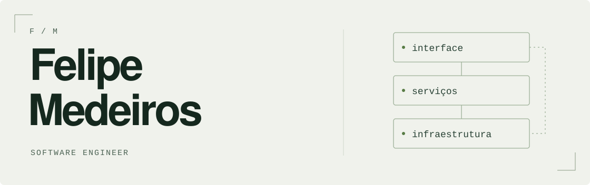

<picture>
  <source media="(prefers-color-scheme: dark) and (max-width: 600px)" srcset="./assets/profile-mobile-dark.svg">
  <source media="(max-width: 600px)" srcset="./assets/profile-mobile-light.svg">
  <source media="(prefers-color-scheme: dark)" srcset="./assets/profile-dark.svg">
  
</picture>

# Construo software de ponta a ponta

Construo software há mais de 10 anos, atuando da compreensão do problema à
entrega de produtos digitais.

Gosto de acompanhar o produto inteiro: entender o problema, desenhar a
arquitetura, construir a interface e cuidar dos serviços que fazem tudo
funcionar. Minha experiência passa por produtos B2B, automação de processos,
agentes de IA e sistemas que precisam evoluir com clareza.

[LinkedIn](https://www.linkedin.com/in/fmedeiros95/) / [E-mail](mailto:medeiros.dev@gmail.com) / [Projetos no GitHub](https://github.com/atmus-tecnologia)

## Produto, sistemas e automação

Ao longo da carreira, participei da construção de plataformas que conectam
atendimento, CRM e automações em fluxos visuais. Também trabalhei com agentes
de IA para interpretar mensagens, qualificar contatos e automatizar etapas
operacionais.

Atuo da concepção do produto à experiência do usuário. A engenharia combina
NestJS e Angular, filas e eventos, busca vetorial e infraestrutura em cloud
com Terraform.

Essa visão de ponta a ponta une decisões de produto, arquitetura, interface,
integrações e operação.

## Algumas peças do meu trabalho

**[Atmus UI](https://github.com/atmus-tecnologia/atmus-ui)**

Componentes Angular com Tailwind CSS, temas, formulários e exemplos de uso.
Uma base compartilhada para construir interfaces com consistência.

**[nestjs-storage](https://github.com/atmus-tecnologia/nestjs-storage)**

A mesma interface para trabalhar com arquivos em S3, Google Cloud Storage,
Azure Blob e armazenamento local.

**[nestjs-openai](https://github.com/atmus-tecnologia/nestjs-openai) e [nestjs-elevenlabs](https://github.com/atmus-tecnologia/nestjs-elevenlabs)**

Integrações de IA com NestJS: cliente OpenAI injetável e recursos de voz com
ElevenLabs, incluindo geração de áudio em streaming.

Mais bibliotecas e experimentos

- [nestjs-cache](https://github.com/atmus-tecnologia/nestjs-cache): cache Redis integrado ao NestJS.
- [nestjs-stripe](https://github.com/atmus-tecnologia/nestjs-stripe): cliente Stripe integrado ao NestJS.
- [golang-rest-api](https://github.com/fmedeiros95/golang-rest-api): estudo de API REST em Go com PostgreSQL.

## Da arquitetura à entrega

Na Lailla, participei da construção da aplicação desde o início: requisitos,
DDD, Clean Architecture, backend em NestJS e frontend em Angular. Também
trabalhei nos processos de versionamento, deploy e monitoramento.

Essa atuação passa por revisão de código, refatoração e orientação técnica.
Gosto de ajudar o time a entender as decisões e a evoluir o sistema.

Tecnologias com que trabalho

**Aplicações:** TypeScript, Node.js, NestJS, Angular, React, Next.js e Tailwind CSS.

**Dados e integrações:** PostgreSQL, Redis, TypeORM, Socket.IO, Bull e APIs REST.

**IA e infraestrutura:** OpenAI, Google AI, LangChain, Qdrant, GCP, AWS, Terraform, Docker e CI/CD.

Também tenho experiência com Vue, PHP, Lua, MySQL e MongoDB.

---

Para conversar sobre produto, engenharia ou uma ideia nova:
[medeiros.dev@gmail.com](mailto:medeiros.dev@gmail.com).
